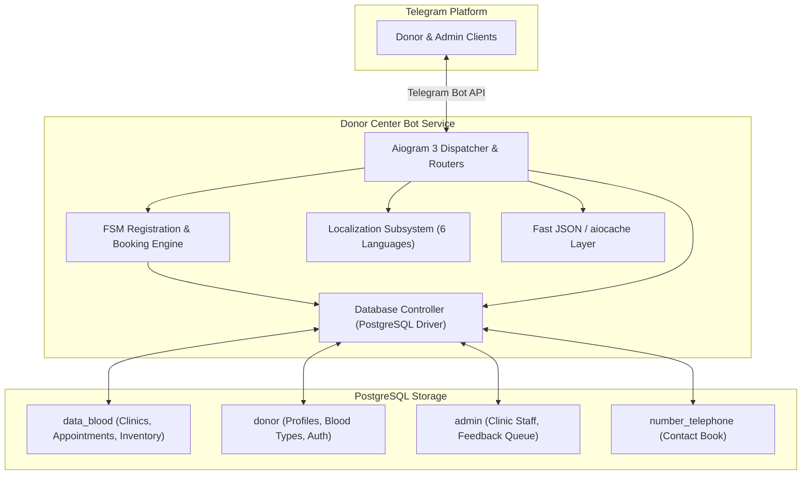

# Kharkiv Donor Center Telegram Bot

[](https://www.python.org/)
[](https://docs.aiogram.dev/)
[](https://www.postgresql.org/)
[](https://www.docker.com/)
[](https://github.com/astral-sh/uv)
[](https://github.com/astral-sh/ruff)

A specialized humanitarian and clinical Telegram bot developed for regional blood donor coordination across medical centers in Kharkiv and surrounding districts. The bot streamlines blood donation scheduling, manages donor records, tracks blood type supply levels across partner clinics, and broadcasts real-time shortage alerts to eligible donors.

---

## Key Features

- **Multilingual Support:** Full native localization across 6 languages (Ukrainian, English, German, French, Chinese, and Russian) with on-the-fly language switching.
- **Donor Registration & Profiles:** Secure Finite State Machine (FSM) onboarding capturing donor blood type (AB+, AB-, A+, A-, B+, B-, O+, O-), contact credentials, birthdate, and preferred medical facilities.
- **Appointment Scheduling:** Real-time booking system allowing donors to schedule donation appointments at designated clinics based on operational hours and available slots.
- **Clinical Supply Tracking:** Administrative panel enabling healthcare staff to update component quantities, review appointment records, and inspect donor histories.
- **Automated Broadcasts & Notifications:** Event-driven notification subsystem notifying registered donors when critical regional blood shortages arise.
- **Cryptographic Security:** Salted SHA-256 password hashing for donor authentication and credential management.

---

## System Architecture



---

## Tech Stack

| Component | Technology | Description |
|---|---|---|
| **Runtime** | Python 3.11+ | Asynchronous core powered by `asyncio` |
| **Bot Framework** | Aiogram 3.x | Modern asynchronous Telegram Bot API framework using routers and filters |
| **Database** | PostgreSQL 16 | Relational store partitioned across specialized schemas (`data_blood`, `donor`, `admin`, `number_telephone`) |
| **Driver** | psycopg2-binary | Robust, high-performance PostgreSQL client |
| **Caching** | aiocache & Local JSON | Rapid lookup for active user states, languages, and notification preferences |
| **Tooling** | uv & Ruff | Lightning-fast package management and linting/formatting standards |
| **Containerization** | Docker & Docker Compose | Multi-stage production container and local development orchestration |

---

## Project Structure

```
├── bot/
│   └── cache/                    # Runtime user cache state (git-ignored)
├── src/
│   ├── classes/                  # Core abstractions
│   │   ├── Controllers/          # Database, Blood, and News controllers
│   │   ├── Datatypes/            # Domain entities (Donor, Clinic, Appointment, etc.)
│   │   ├── CRMBot.py             # Main Aiogram Bot singleton
│   │   ├── Crypto.py             # Cryptographic helpers (Salted SHA-256)
│   │   ├── Form.py               # FSM registration states
│   │   └── Keyboards.py          # Dynamic multilingual keyboard generator
│   ├── funcs/                    # Utility helpers (translation, formatting, debug)
│   ├── handlers/                 # Aiogram routers (registration, booking, stats, admin)
│   ├── keyboards/                # Keyboard layout builders
│   └── lang/                     # JSON localization files (uk, en, de, fr, cn, ru)
├── bot_app.py                    # Application entry point
├── config.py                     # Environment-based configuration loader
├── db/
│   └── init.sql                  # Automated database schema initialization script
├── Dockerfile                    # Multi-stage container definition
├── docker-compose.yml            # Full-stack bot and PostgreSQL orchestration
├── pyproject.toml                # uv and Ruff configuration
└── uv.lock                       # Deterministic dependency lockfile
```

---

## Quickstart Guide

### Option 1: Docker Compose (Recommended)

To run the complete system (bot + PostgreSQL database) with a single command:

1. **Clone the repository and prepare environment variables:**
   ```bash
   cp .env.example .env
   ```

2. **Configure your Telegram Bot token in `.env`:**
   ```env
   BOT_TOKEN=your_actual_telegram_bot_token_here
   POSTGRES_DB=crm
   POSTGRES_USER=postgres
   POSTGRES_PASSWORD=postgres
   ```

3. **Start the containers:**
   ```bash
   docker compose up --build
   ```

The PostgreSQL service initializes required schemas and tables automatically, and the bot connects upon database readiness.

---

### Option 2: Local Development with `uv`

1. **Prerequisites:**
   - Python 3.11+
   - [`uv`](https://github.com/astral-sh/uv) installed
   - A running PostgreSQL instance

2. **Install dependencies and sync environment:**
   ```bash
   uv sync
   ```

3. **Configure environment:**
   ```bash
   cp .env.example .env
   # Edit .env with your BOT_TOKEN and database credentials
   ```

4. **Initialize database schema (if not previously configured):**
   ```bash
   psql -U postgres -d crm -f db/init.sql
   ```

5. **Start the bot:**
   ```bash
   uv run python bot_app.py
   ```

---

## Configuration Reference

The application reads all settings from environment variables or a root `.env` file:

| Variable | Description | Default |
|---|---|---|
| `BOT_TOKEN` | Telegram Bot API token obtained from @BotFather | *Required for production* |
| `DEFAULT_LANGUAGE` | Default fallback UI language code | `en-EN` |
| `NEED_DEBUG` | Enables verbose terminal diagnostic logging | `True` |
| `POSTGRES_DB` | PostgreSQL database name | `crm` |
| `POSTGRES_HOST` | Host address of PostgreSQL server | `localhost` |
| `POSTGRES_PORT` | Port of PostgreSQL server | `5432` |
| `POSTGRES_USER` | Database user | `postgres` |
| `POSTGRES_PASSWORD`| Database password | `postgres` |

---

## Code Quality & Tooling

Code quality is enforced via **Ruff**:

```bash
# Run linter
uv run ruff check .

# Automatically apply lint fixes
uv run ruff check --fix .

# Format code
uv run ruff format .
```

---

## License

This project is licensed under the MIT License.
